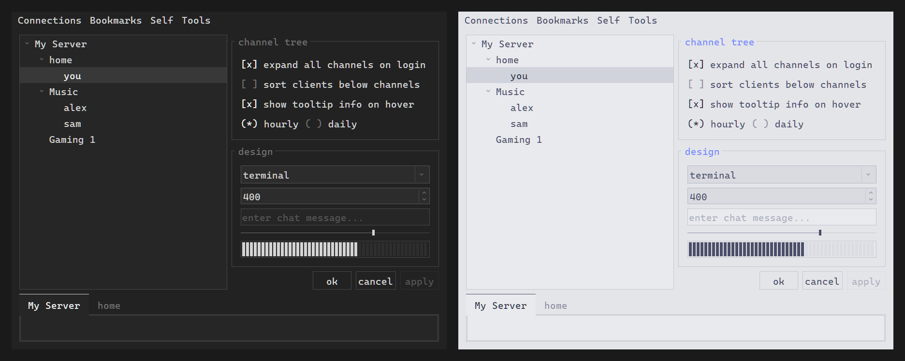
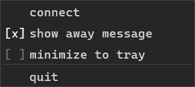
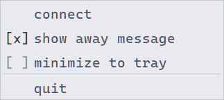

# Terminal style for TeamSpeak 3

[](https://github.com/Meti0X7CB/ts3-terminal-style/releases/latest)
[](LICENSE)


A flat, monospace, TUI-looking theme for the TeamSpeak 3 desktop client on Windows.



<sub>Dark and light mode side by side. The style switches automatically with your Windows app mode.</sub>

<table>
  <tr>
    <td></td>
    <td></td>
  </tr>
</table>

**[Download the latest release →](https://github.com/Meti0X7CB/ts3-terminal-style/releases/latest)**

- Checkboxes draw as `[x]` / `[ ]`, radio buttons as `(*)` / `( )`, group boxes as line frames
  with the title set into the border, progress bars as cells.
- **Follows Windows light/dark mode**, live, including the window title bars.
- Monospace everywhere (Geist Mono → JetBrains Mono → Cascadia Mono → Consolas, whichever is installed).
- A matching grey icon pack, generated from TeamSpeak's own icons at install time.

It is a real Qt style plugin (`terminalstyle.dll`), not just a stylesheet, so it can draw things
`.qss` files can't.

## Requirements

- Windows 10 (20H1 or newer) or Windows 11, 64-bit
- TeamSpeak 3 client **3.5.x or 3.6.x** (64-bit) — these use Qt 5.15, which the plugin is built against

No other runtime is needed (the plugin links the C++ runtime statically).

## Install

1. Close TeamSpeak completely (also from the tray).
2. Double-click **`install.cmd`**. If TeamSpeak is in `Program Files`, Windows asks for administrator rights.
3. Start TeamSpeak → **Tools → Options → Design** and set
   **Style** = `Terminal`, **Theme** = `tui`, **Icon pack** = `terminal`.
4. Restart TeamSpeak once.

If TeamSpeak lives somewhere unusual:

```
powershell -ExecutionPolicy Bypass -File install.ps1 -TeamSpeakPath "D:\Apps\TeamSpeak 3 Client"
```

## Uninstall

Close TeamSpeak and double-click **`uninstall.cmd`**. TeamSpeak returns to its defaults on the next start.

## What gets installed

| File | Purpose |
|---|---|
| `styles\terminalstyle.dll` | the Qt style |
| `styles\tui.qss`, `tui_chat.qss` (+ `_darkmode` copies) | companion theme: removes banners/watermarks, neutral chat colours |
| `styles\tui\` | copy of your `styles\default` folder (TeamSpeak needs one per theme) |
| `gfx\terminal.zip` | icon pack, recoloured from your `gfx\default_mono_2014.zip` |

Nothing outside the TeamSpeak folder is touched.

## Known limits

- Icons uploaded by a server (channel/group icons) and avatars keep their own colours.
- Choosing the old **Theme** stylesheets together with this style hides most of its look —
  use the `tui` theme.
- After switching away from the style, fonts stay monospace until TeamSpeak restarts.

## Troubleshooting

Set the environment variable `TERMINAL_STYLE_LOG=1` before starting TeamSpeak to write
`%TEMP%\terminalstyle.log` (chosen theme, title bar calls). `TERMINAL_THEME=light|dark` forces a theme.

## Building from source

Needs Visual Studio Build Tools (C++ workload) and Qt **5.15.2 msvc2019_64**, e.g.

```
winget install --id Microsoft.VisualStudio.BuildTools --override "--quiet --wait --add Microsoft.VisualStudio.Workload.VCTools --includeRecommended"
pip install aqtinstall
python -m aqt install-qt windows desktop 5.15.2 win64_msvc2019_64 -O C:\Qt
```

Then run `build.cmd` (builds `build\styles\terminalstyle.dll` and renders `build\gallery.png`)
and `package.ps1` (creates the shareable zip in `dist\`).

## License

MIT — see [LICENSE](LICENSE). The plugin links against Qt 5.15 (LGPLv3) dynamically,
using the Qt libraries already shipped with TeamSpeak.

## Disclaimer

Not affiliated with or endorsed by TeamSpeak Systems GmbH. "TeamSpeak" is their trademark.
This package contains no TeamSpeak files; the icon pack and theme folder are generated from
your own installation.
